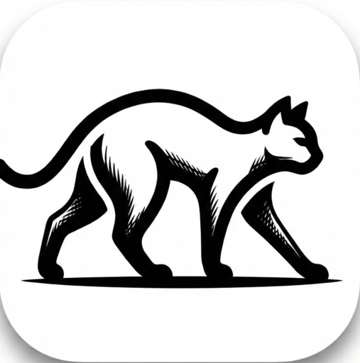
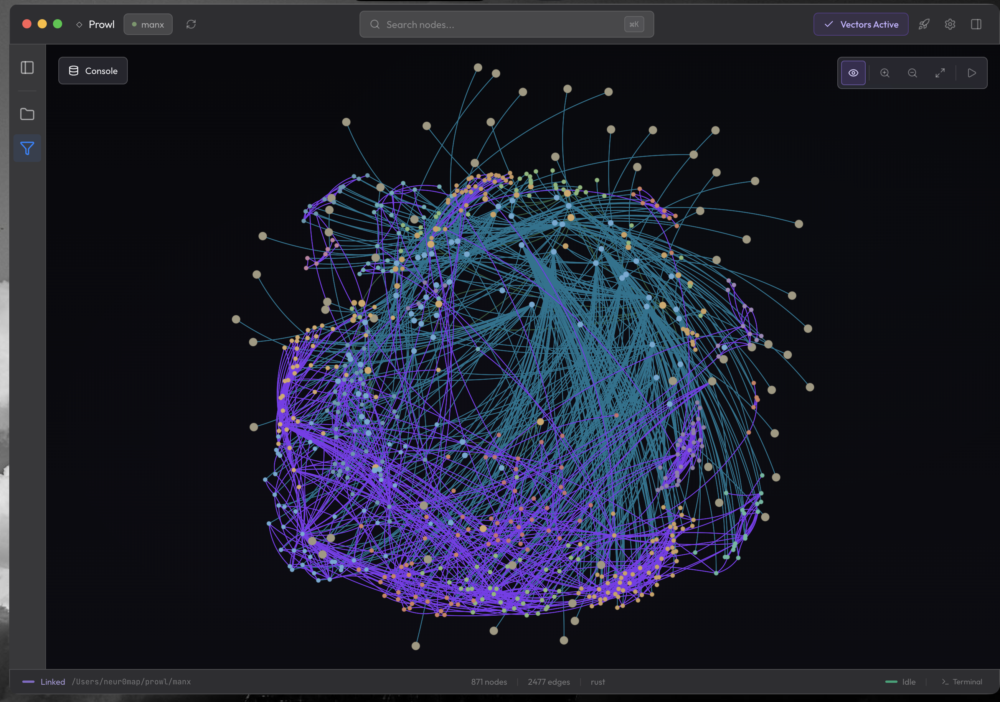
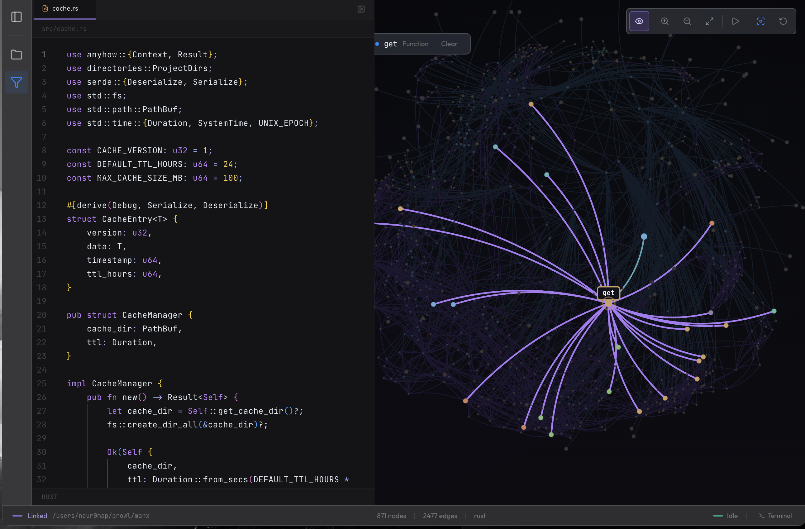

<div align="center">



# Prowl

**Your second monitor while AI writes the code.**

See what your AI coder is actually doing — a live visual map of your entire project that lights up as files change.

[](https://github.com/neur0map/prowl/releases)
[](#)
[](LICENSE)
[](https://nodejs.org)
[](https://github.com/neur0map/prowl/pulls)

<br />

### [Download for macOS (Apple Silicon)](https://github.com/neur0map/prowl/releases/latest) · [macOS (Intel)](https://github.com/neur0map/prowl/releases/latest) · [Windows](https://github.com/neur0map/prowl/releases/latest) · [Linux](https://github.com/neur0map/prowl/releases/latest)

<br />



</div>

---

## What is Prowl?

Prowl is a desktop app that sits next to your AI coding tool. You open your project, and Prowl builds an interactive map of every file, function, and connection. When your AI starts writing code, you watch the map update live.

**It works with any AI coder:** Claude Code, Cursor, Codex, Gemini CLI, Aider, Windsurf — anything that edits files.

**You don't need to be a programmer to use it.** If you can drag a folder onto an app, you can use Prowl.

---

## How It Works

```
1. Open your project folder in Prowl
         |
2. Prowl builds a visual map of your codebase
         |
3. Run your AI coder (in Prowl's terminal or your own)
         |
4. Watch files light up as they change
         |
5. Curious about something? Ask Prowl's chat
```

---

## Why You Need This

You're shipping with AI writing most of the code. Claude, Codex, or Gemini running in your terminal. Files appearing, changing, disappearing. You're watching text scroll by, hoping nothing breaks.

**Prowl gives you the picture.**

| Without Prowl | With Prowl |
|---------------|------------|
| Staring at terminal output, guessing what changed | See files light up on a map in real time |
| Asking your AI coder "what does this file do?" (wasting tokens) | Ask Prowl instead — it knows your whole codebase |
| Searching through folders for "the thing that handles login" | The map shows connections, the chat finds it instantly |
| No idea if the AI broke something | See which files were touched and how they connect |
| Want to look at a GitHub repo before cloning | Paste the URL into Prowl and browse it visually |

---

## Features

- **Live graph** — Your entire project as an interactive map. Nodes light up as files change.
- **Built-in terminal** — Run Claude Code, Aider, or any tool right inside Prowl.
- **Ask questions** — Chat about your codebase without burning tokens in your main AI.
- **Code viewer** — Click any node to read the code. Edit if you need to.
- **GitHub import** — Paste a repo URL to explore it without cloning.
- **Smart search** — Find code by meaning, not just keywords.
- **Works offline** — Everything runs locally on your machine. No data leaves your computer.

---

## Download & Install

Go to the **[Releases page](https://github.com/neur0map/prowl/releases/latest)** and download the right file for your system:

| System | File to download |
|--------|------------------|
| Mac (Apple Silicon — M1/M2/M3/M4) | `Prowl-x.x.x-mac-arm64.dmg` |
| Mac (Intel) | `Prowl-x.x.x-mac-x64.dmg` |
| Windows | `Prowl-x.x.x-win-x64-setup.exe` |
| Linux | `Prowl-x.x.x-linux-x86_64.AppImage` or `.deb` |

### macOS first launch

The app isn't code-signed yet, so macOS will block it. To open it:

1. **Drag Prowl to Applications** like any other app
2. **Right-click** the app and choose **Open**
3. Click **Open** in the dialog that appears
4. macOS will ask about **keychain access** — click **Always Allow** (this stores your settings securely)

That's it. You only need to do this once.

> Code signing is coming soon. Once signed, these steps won't be needed.

---

## Getting Started

1. **Open Prowl**
2. **Drop a folder** onto the window (or click to browse)
3. **Wait a few seconds** while Prowl maps your project
4. **Explore the graph** — zoom, pan, click on nodes
5. **Open the terminal tab** and start your AI coder
6. **Watch the graph** update as your AI makes changes

You can also paste a **GitHub URL** to explore any public repo without downloading it.

---

## Supported Languages

JavaScript, TypeScript, Python, Java, Go, Rust, C, C++, C#

---

## AI Chat Providers

Prowl's built-in chat works with:

**OpenAI** · **Anthropic** · **Google Gemini** · **Azure OpenAI** · **Ollama** (local) · **OpenRouter** · **Groq**

Set up your API key in Settings. Keys are stored securely in your system's keychain.

---

## Screenshots

### Focus Graph


### Code Inspector


---

<details>
<summary><strong>For Developers</strong></summary>

### Building from Source

**Prerequisites:** Node.js 18+, Python 3.x with setuptools, Git

```bash
git clone https://github.com/neur0map/prowl.git
cd prowl
npm install
npm run dev
```

### Packaging

```bash
npm run dist:mac       # macOS DMG
npm run dist:win       # Windows installer
npm run dist:linux     # Linux AppImage/deb
npm run dist           # All platforms
```

### Python note

If you're on Python 3.12+ and get a `distutils` error:

```bash
pip3 install setuptools
```

### Tech Stack

| Category | Technology |
|----------|------------|
| Framework | Electron, React, TypeScript |
| Styling | Tailwind CSS v4 |
| Graph | Sigma.js, graphology |
| Parsing | tree-sitter WASM |
| Database | KuzuDB WASM |
| Embeddings | Snowflake Arctic Embed XS (WebGPU/WASM) |
| AI | LangChain |
| Terminal | xterm.js, node-pty |
| Editor | Monaco |
| Build | electron-vite |

</details>

---

## Star History

[](https://star-history.com/#neur0map/prowl&Date)

---

## Contributing

PRs welcome. Open an issue first for major changes.

---

## License

[Boost Software License 1.0](LICENSE)
